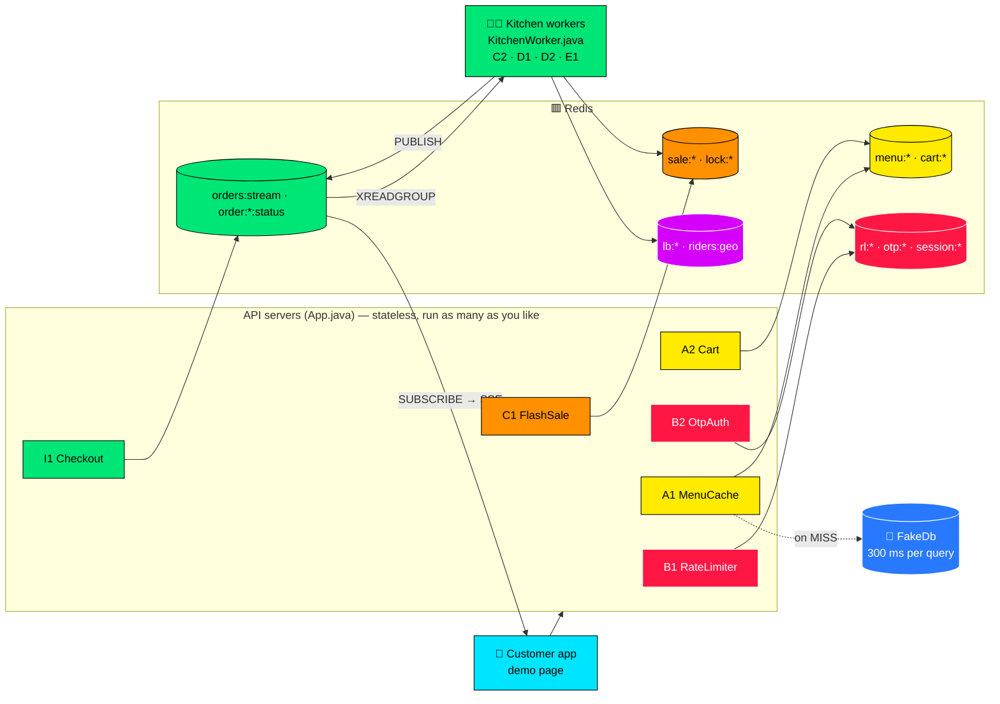
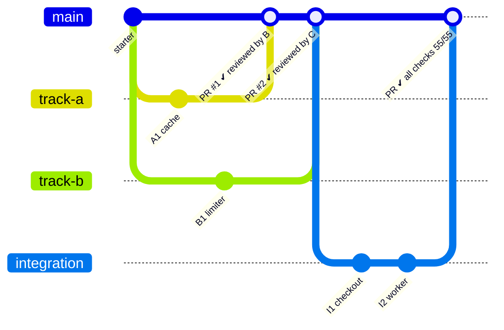

# Assignment 2 — QuickBite on Redis 🟥 (group project)

You've built QuickBite's APIs. Now it has a million users, and Postgres is on fire.
Your team will add **10 features to QuickBite, each built on a different Redis data structure** — the same features Swiggy, Zomato, Uber and Stripe run on Redis in production.

By the end, every member can answer the interview question *"Where would you use Redis here, and which data structure?"* — because you've built each answer.

| # | Feature | Redis structure | The pattern you'll be able to explain in an interview |
|---|---|---|---|
| A1 | Menu cache | `STRING` + TTL | Cache-aside, invalidation, TTL jitter, cache stampede |
| A2 | Shopping cart | `HASH` | Per-field updates, sliding expiry |
| B1 | Rate limiter | `INCR` counter · `ZSET` | Fixed vs sliding window, atomicity with Lua |
| B2 | OTP login + sessions | `STRING` + TTL · `HASH` | Expiring codes, brute-force lockout, shared sessions |
| C1 | ₹1 flash sale | Counter + `SET` + **Lua** | Check-then-act race conditions, no overselling |
| C2 | Rider assignment lock | `SET NX PX` + Lua | Distributed locks, safe unlock, lock expiry |
| D1 | Top restaurants this week | `ZSET` | Leaderboards, ranks |
| D2 | Riders near me | `GEO` | Radius search, heartbeats, lazy cleanup |
| E1 | Live order status | **Pub/Sub** | Fan-out across servers (Assignment 1's SSE, now multi-server) |
| E2 | Order queue | **Streams** + consumer group | Reliable queues, acks, crash recovery |

## The system you're building



## Your team: 4–5 people, one track each

| Track | Owner | Files you own | Spec | Feel |
|---|---|---|---|---|
| 🟨 **A — Speed** | member 1 | `MenuCache.java`, `Cart.java` | [docs/TRACK-A.md](docs/TRACK-A.md) | Easiest start; most-used pattern in the industry |
| 🟥 **B — Protection** | member 2 | `RateLimiter.java`, `OtpAuth.java` | [docs/TRACK-B.md](docs/TRACK-B.md) | Your first Lua script |
| 🟧 **C — Correctness** | member 3 | `FlashSale.java`, `RiderLock.java` | [docs/TRACK-C.md](docs/TRACK-C.md) | Race conditions; the checker fires 400 threads at you |
| 🟪 **D — Real-time data** | member 4 | `Leaderboard.java`, `NearbyRiders.java` | [docs/TRACK-D.md](docs/TRACK-D.md) | Sorted sets and geo, very visual |
| 🟩 **E — Events + glue** | member 5 *or everyone* | `LiveUpdates.java`, `OrderPipeline.java`, `Checkout.java`, `KitchenWorker.java` | [docs/TRACK-E.md](docs/TRACK-E.md) | Pub/Sub, Streams, and wiring everyone's work together |

**Team of 4?** Split E1/E2 between two members in week 1, and write `Checkout` + `KitchenWorker.process` together in week 2 (pair or mob programming).
**Everyone** answers [docs/DESIGN.md](docs/DESIGN.md) together and keeps [docs/KEYS.md](docs/KEYS.md) up to date.

Each feature lives in its own file, so five people can work in parallel without merge conflicts. Nobody needs to edit `App.java`, `Redis.java`, `Http.java`, `Json.java` or `FakeDb.java`.

## Setup (do this together on day 0 — 20 minutes)

1. **Java 21+** — `java -version`. No Maven, no Spring: the project compiles with plain `javac`.
2. **Redis 7** — easiest is Docker:
   ```bash
   docker compose up -d            # Redis on :6379 + RedisInsight (a GUI for your keys) on http://localhost:5540
   docker compose exec redis redis-cli ping      # -> PONG
   ```
   No Docker? macOS: `brew install redis && redis-server`. Linux: `sudo apt install redis-server`. Windows: use WSL (`sudo apt install redis-server`), or a free [Redis Cloud](https://redis.io/try-free/) database and set `REDIS_HOST`, `REDIS_PORT`, `REDIS_PASSWORD`.
3. **Run the checker** — every test should fail with `TODO(n) not implemented yet`. That's your to-do list.
   ```bash
   ./run.sh check          # Windows: run.cmd check
   ./run.sh check A        # just your track
   ```
4. **Run the app** — `./run.sh`, then open **http://localhost:8080**. Each card on the page is one feature and starts working the moment its owner finishes it.

Keep `redis-cli MONITOR` open in a terminal while you work. You'll see every command your code sends — the fastest way to debug.

## How the code talks to Redis

There's no Redis library. `Redis.java` (≈150 lines, read it!) lets you send **exactly what you'd type in `redis-cli`**:

```java
Redis.call("SET", "menu:r1", json, "EX", 60);            // -> "OK"
String v   = Redis.str("GET", "menu:r1");                 // -> value or null
long n     = Redis.num("INCR", "rl:fixed:u1:29812345");   // -> number
List<Object> top = Redis.list("ZREVRANGE", "lb:restaurants:2026-W47", 0, 9, "WITHSCORES");
Object r   = Redis.eval(luaScript, List.of(key1, key2), arg1, arg2);
```
We do this on purpose: you learn **Redis commands**, which work in any language. In a real project you'd use Jedis or Lettuce (Java), redis-py or ioredis; the commands are the same.
**Practise each command in `redis-cli` before writing the Java** — every track doc has a warm-up.

## Working as a team (this is graded)



1. One repo per group. Branch per track: `track-a`, `track-b`, …
2. **Before you write code**, add your keys to `docs/KEYS.md` (name, type, TTL, example) and open a PR. Two features silently sharing a key name is a real production bug.
3. Every PR must be reviewed and approved by **someone from another track**. The reviewer runs `./run.sh check <track>` and leaves at least one comment. This is how everyone learns all ten features.
4. A short daily standup message in your group chat: done / doing / blocked.

## Timeline (suggested: 2 weeks)

| When | Goal |
|---|---|
| Day 0 (together) | Setup, everyone sees 55 failing checks, fill `KEYS.md`, read all five track docs |
| Days 1–4 | Each member finishes their track: `./run.sh check <track>` all green, PR reviewed and merged |
| Days 5–7 | Track E glue (`Checkout`, `KitchenWorker.process`), full `./run.sh check` → **55 passed** |
| Days 8–10 | `DESIGN.md` answers, stretch goals, demo rehearsal |
| Demo day | 15-minute live demo (script below) + Q&A |

## Deliverables

1. **Code:** `./run.sh check` → `55 passed, 0 failed`.
2. **`docs/KEYS.md`:** every key your app writes, with type, TTL and owner.
3. **`docs/DESIGN.md`:** the group's answers to the system-design questions.
4. **Demo (15 min, live):**
   1. Log in with OTP. Show `otp:*` and `session:*` keys in RedisInsight, with their TTLs.
   2. Open a menu twice: MISS (≈300 ms) → HIT (≈1 ms). Change a price, then show the cache was invalidated.
   3. Flash sale: run "naive" and then "Lua", and explain why one oversells.
   4. Spam the rate limiter; explain sliding vs fixed window.
   5. Start 2 workers, place an order, and show the live timeline. Then start a `--crash` worker, place another order, and show it being rescued about 15 s later.
   6. Leaderboard and nearby riders.
   7. **Cross-explain:** the instructor picks a feature, and someone who did *not* build it explains it.

## Grading (100 points)

| Area | Points | What we look for |
|---|---|---|
| Checks passing | 35 | Your track's tests (5 per track, ×5) + the two integration sections (10) |
| Redis usage | 15 | Every key has a TTL or a documented reason not to; no `KEYS *` in code; atomic where it must be |
| `KEYS.md` | 5 | Complete and accurate |
| `DESIGN.md` | 20 | Reasoned answers with trade-offs, not one-liners |
| Demo + cross-explain | 15 | Every member can explain a feature they didn't build |
| Teamwork | 10 | Branches, reviewed PRs with real comments, commits from every member |
| Stretch goals | +10 bonus | Any from the track docs |

## Commands

```bash
./run.sh                    # API + demo page on http://localhost:8080
./run.sh check [A-E]        # automatic checks (needs Redis, not the app)
./run.sh worker w1          # a kitchen worker (start 2-3 of them!)
./run.sh worker w9 --crash  # takes one order and dies without XACK
redis-cli MONITOR           # watch every command live
redis-cli --scan --pattern 'menu:*'      # list keys safely (never KEYS * in production)
```
