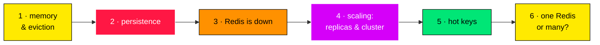

# Design questions — answer as a team

These are system-design interview questions about **the system you just built**. Each answer should be 5–10 lines and name a trade-off. "It depends" is fine *if* you say on what.

### 1. Memory and eviction
Using your estimate from `KEYS.md`, how big must Redis be? Redis fills up. Compare `maxmemory-policy` options `noeviction`, `allkeys-lru` and `volatile-lru` for **our** key mix. Which of our keys would it be a disaster to evict (sessions? the stream? flash-sale stock?) and which are fine (menus)? Which policy do you pick?

### 2. Persistence
Redis restarts. Which of our features lose data that matters, and which don't care? Compare RDB snapshots and AOF (`appendfsync everysec`). Our `docker-compose.yml` turns on AOF. Is that enough for the flash-sale stock and the order stream?

### 3. Redis is down for 2 minutes
For **each** feature, what does the user see, and what *should* happen? Fill the table:

| Feature | What breaks today | What we should do (fail open / closed / fallback) |
|---|---|---|
| Menu cache | | |
| Cart | | |
| Rate limiter | | |
| OTP / sessions | | |
| Flash sale | | |
| Rider lock | | |
| Leaderboard | | |
| Nearby riders | | |
| Live updates | | |
| Order queue | | |

### 4. Scaling: replicas and Redis Cluster
a) We add read replicas. Which reads can safely go to a replica (replication is async, so it may be slightly stale), and which must hit the primary?
b) We move to **Redis Cluster** (keys spread across nodes by hash slot). `FlashSale.BUY_LUA` touches `sale:{id}:stock` and `sale:{id}:buyers`. Will it still work? Look up **hash tags** (`sale:{biryani}:stock`) and fix the key names.
c) Which other multi-key command in our code has the same problem?

### 5. Hot keys
At 8 PM, 200,000 users open Dosa Junction's menu in the same minute. All of them read `menu:r1`, which lives on **one** Redis node. What breaks, and what are two fixes? (Local in-process cache, key replicas like `menu:r1:{0..9}`.)

### 6. One Redis or several?
We put caches, sessions, rate limits, locks and the order queue in one Redis. Argue for splitting them into separate instances (or a separate database for the queue). What would you split first, and why?

### 7. Redis vs the alternatives (one line each)
- Order queue: Redis Streams vs Kafka vs RabbitMQ / SQS
- Sessions: Redis vs JWT
- Rider search: Redis GEO vs PostGIS vs Elasticsearch
- Locks: Redis vs ZooKeeper / etcd vs a Postgres row lock
