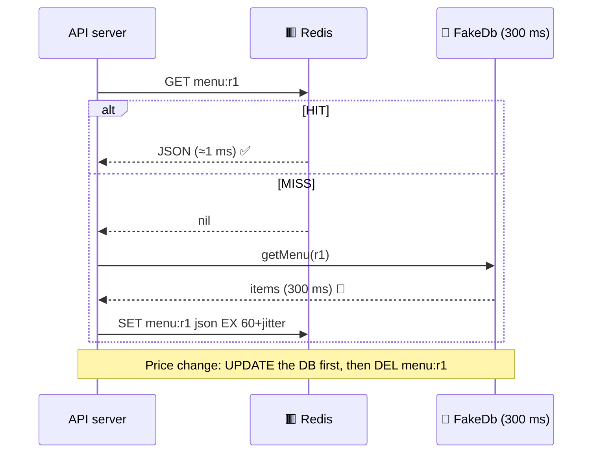

# 🟨 Track A — Speed: menu cache + cart

**Files:** `src/MenuCache.java`, `src/Cart.java`  **Check:** `./run.sh check A`  **Demo cards:** 2 (Menu), 3 (Order)

## Warm-up in `redis-cli` (10 min)
```
SET menu:r1 '[{"name":"Masala Dosa"}]' EX 60
GET menu:r1
TTL menu:r1                    # counts down; -2 = gone, -1 = no expiry (a leak!)
DEL menu:r1

HINCRBY cart:u1 masala-dosa 2
HINCRBY cart:u1 masala-dosa 1
HINCRBY cart:u1 filter-coffee 1
HGETALL cart:u1
HDEL cart:u1 filter-coffee
EXPIRE cart:u1 1800
```

## A1 — Menu cache (cache-aside)



| TODO | Method | What |
|---|---|---|
| 1 | `getMenu` | GET → on a miss, load from the DB → SET with EX and jitter |
| 2 | `updatePrice` | Update the DB, then **DEL** the cache |
| Stretch 3 | `getMenuProtected` | Stampede lock with `SET lock:menu:{id} 1 NX PX 2000` |

## A2 — Cart (HASH)

| TODO | Method | What |
|---|---|---|
| 1 | `addItem` | `HINCRBY`, `HDEL` at ≤ 0, `EXPIRE` the whole cart |
| 2 | `items` | `HGETALL` → `Map` |
| 3 | `clear` | `DEL` |

## Think & answer (write these in your PR description)
1. Your cache hit takes about 1 ms and a miss about 300 ms. With a 95% hit rate, what's the average latency? And at 50%?
2. **Why the random TTL jitter?** Picture 10,000 menus cached at 9:00:00 with exactly 60 s TTL.
3. **Why DEL the cache instead of SET-ting the new menu** after an update? Walk through two concurrent updates (or a slow reader) and see which approach leaves stale data.
4. Someone requests `/restaurants/r404/menu` 1,000 times a second. Every call misses the cache *and* hits the DB. This is "cache penetration". How would you stop it? (Caching "null" briefly, a Bloom filter.)
5. Why a HASH for the cart instead of one JSON string? What does `HINCRBY` give you that GET → modify → SET doesn't?
6. `HINCRBY` followed by `HDEL` is two commands. Can a concurrent request see a cart line with qty `-1`? Does it matter here? How would you make it atomic?
7. Redis runs out of memory. Which of your keys can Redis safely evict, and which can't? (Look up `maxmemory-policy`.)

## Stretch
- Stampede protection (TODO 3). The checker has a `[STRETCH]` test for it.
- Add `X-Cache` hit/miss counters in Redis (`INCR stats:menu:hit`) and show the hit rate on the demo page.
- Cache the restaurant list for the home screen, and invalidate it when any restaurant changes.
