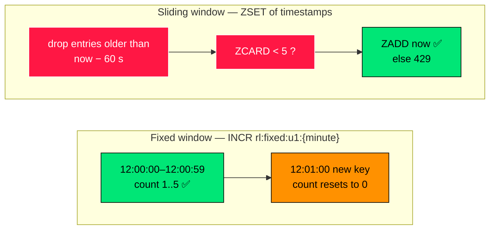
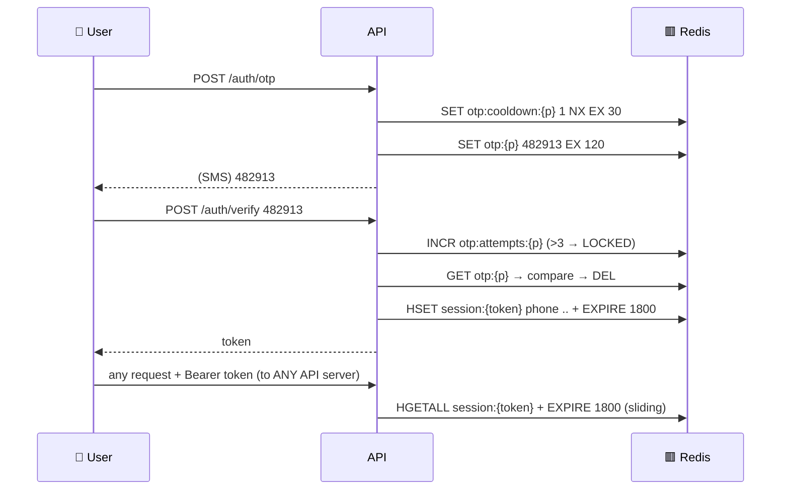

# 🟥 Track B — Protection: rate limiter + OTP login

**Files:** `src/RateLimiter.java`, `src/OtpAuth.java`  **Check:** `./run.sh check B`  **Demo cards:** 1 (Log in), 4 (Spam the API)

## Warm-up in `redis-cli` (10 min)
```
INCR rl:fixed:u1:100          # 1
INCR rl:fixed:u1:100          # 2
EXPIRE rl:fixed:u1:100 60

ZADD rl:sliding:u1 1000 a 2000 b 3000 c
ZREMRANGEBYSCORE rl:sliding:u1 0 1500      # drops "a"
ZCARD rl:sliding:u1
ZRANGE rl:sliding:u1 0 0 WITHSCORES        # the oldest

EVAL "return redis.call('INCR', KEYS[1])" 1 counter     # your first Lua script

SET otp:cooldown:999 1 NX EX 30            # OK
SET otp:cooldown:999 1 NX EX 30            # (nil)  <- "already exists"
HSET session:abc phone 999 createdAt 1731
HGETALL session:abc
```

## B1 — Rate limiter



| TODO | Method | What |
|---|---|---|
| 1 | `fixedWindow` | `INCR` + `EXPIRE` on the first hit |
| 2 | `SLIDING_LUA` + `slidingWindow` | ZSET log; all steps in **one Lua script** so it's atomic |

## B2 — OTP + sessions



| TODO | Method | What |
|---|---|---|
| 1 | `requestOtp` | Cooldown with `SET NX EX`, store the code with a TTL |
| 2 | `verifyOtp` | Attempts counter → lockout, compare, one-time use, create the session |
| 3 | `session` | `HGETALL` + sliding `EXPIRE` |
| 4 | `logout` | `DEL` |

## Think & answer
1. **The boundary burst:** with a fixed window of 5/min, how can a user make 10 requests in 2 seconds? Try it on the demo page at hh:mm:58. Why can't that happen with the sliding window?
2. The sliding window stores one ZSET entry per request. A user allowed 1,000 req/min costs how much memory? What's the cheaper middle ground? (Search: "sliding window counter", "token bucket".)
3. Why does the sliding window *need* Lua, when the fixed window is safe with plain `INCR`?
4. A 6-digit OTP has 1,000,000 possibilities. With 3 attempts per code and a new code every 30 s, roughly how long would brute force take? What else would you rate-limit? (Hint: per IP, per phone per day.)
5. Why count the attempt **before** checking the code?
6. Sessions in Redis vs a JWT. How do you log a user out *everywhere* with each? What happens to each if Redis goes down?
7. If Redis is down, should the rate limiter **fail open** (allow everything) or **fail closed** (block everything)? Does the answer differ for login vs checkout?

## Stretch
- Token bucket in Lua (`HSET bucket tokens lastRefill`), allowing bursts of 10 with a refill of 1/s.
- "Log out of all devices": keep `user:{phone}:sessions` as a SET of tokens.
- Show `X-RateLimit-Remaining` on every API response, not just the demo endpoint.
