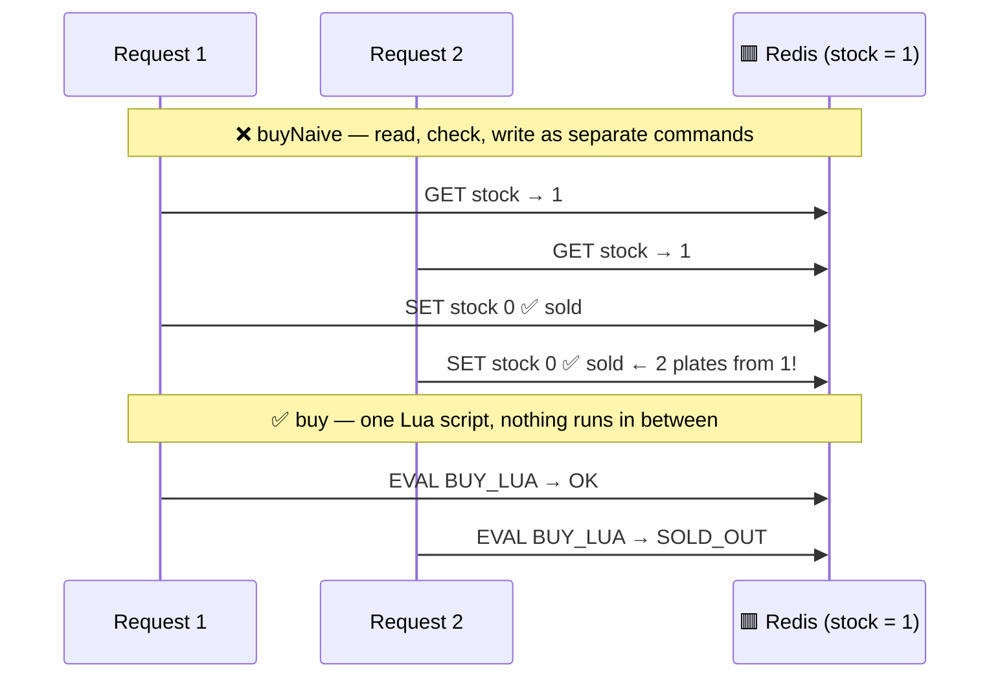
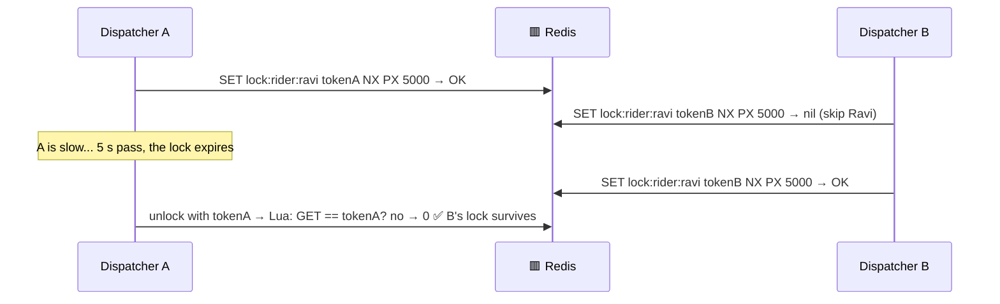

# 🟧 Track C — Correctness: flash sale + distributed lock

**Files:** `src/FlashSale.java`, `src/RiderLock.java`  **Check:** `./run.sh check C`  **Demo card:** 5 (Flash sale)

## Warm-up in `redis-cli` (10 min)
```
SET sale:test:stock 2
EVAL "local s = tonumber(redis.call('GET', KEYS[1])) if s > 0 then return redis.call('DECR', KEYS[1]) end return -1" 1 sale:test:stock
# run it 3 times: 1, 0, -1

SET lock:rider:ravi tokenA NX PX 10000     # OK
SET lock:rider:ravi tokenB NX PX 10000     # (nil)
PTTL lock:rider:ravi
```
Run `./run.sh check C` **before** writing any code and read the `[INFO]` line. `buyNaive` sells far more than the stock. That's the bug you're fixing.

## C1 — Flash sale



| TODO | What |
|---|---|
| 1 | `BUY_LUA`: SISMEMBER → GET → DECR + SADD, all in one script |
| 2 | `buy`: run it with `Redis.eval` |

## C2 — Distributed lock



| TODO | Method | What |
|---|---|---|
| 1 | `tryLock` | `SET NX PX` with a random token |
| 2 | `UNLOCK_LUA` + `unlock` | Compare-and-delete, atomically |
| 3 | `assignRider` | Lock → check free → assign → unlock (in `finally`) |

## Think & answer
1. `DECR` alone is atomic. Why not just `DECR` and, if the result is negative, `INCR` it back? What goes wrong (and what's shown to users) during the sale?
2. Lua scripts block Redis while they run. What happens to every other feature if someone writes a script with a loop over 1 million items?
3. Why does the lock need an expiry? And why does the expiry create the "slow holder" problem the checker tests?
4. Look at `assignRider`. Could `SET rider:{r}:order {orderId} NX` replace the whole lock? When *do* you genuinely need a lock rather than one atomic command?
5. The lock lives on one Redis. If that Redis fails over to a replica before replicating your lock, two dispatchers can hold it. Read about **Redlock** and Martin Kleppmann's critique ("fencing tokens"). In one paragraph: when is a Redis lock good enough?
6. 20,000 users, 100 plates. After the sale, how do you create the 100 real orders in Postgres without losing any if a server crashes mid-way? (Hint: Track E's stream.)

## Stretch
- A "waiting list": after the sale sells out, keep the next 50 users in a LIST, and promote them if a buyer cancels.
- Lock with **auto-renew** (a watchdog thread extends PTTL while work continues), like Redisson does.
- Add a `/sales/{id}` live counter on the demo page using Track E's Pub/Sub.
