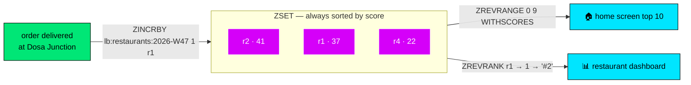
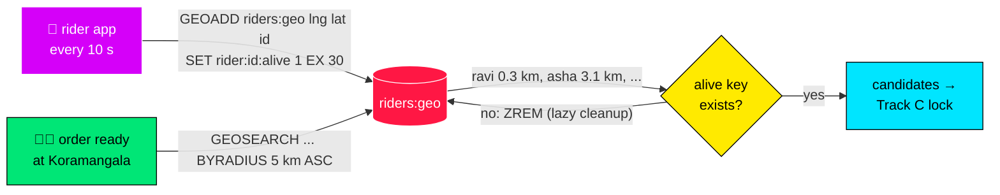

# 🟪 Track D — Real-time data: leaderboard + nearby riders

**Files:** `src/Leaderboard.java`, `src/NearbyRiders.java`  **Check:** `./run.sh check D`  **Demo cards:** 6 (Top restaurants), 7 (Riders)

## Warm-up in `redis-cli` (10 min)
```
ZINCRBY lb:test 1 r1
ZINCRBY lb:test 5 r2
ZINCRBY lb:test 3 r3
ZREVRANGE lb:test 0 2 WITHSCORES      # highest first
ZREVRANK lb:test r3                   # 0-based rank
ZSCORE lb:test r3

GEOADD riders:test 77.6245 12.9352 ravi        # LONGITUDE first!
GEOADD riders:test 77.6412 12.9719 imran
GEODIST riders:test ravi imran km
GEOSEARCH riders:test FROMLONLAT 77.626 12.934 BYRADIUS 5 km ASC WITHDIST
TYPE riders:test                      # zset! GEO is a sorted set with geohash scores
```

## D1 — Leaderboard



| TODO | Method | What |
|---|---|---|
| 1 | `recordOrder` | `ZINCRBY` + `EXPIRE` 8 days |
| 2 | `top` | `ZREVRANGE ... WITHSCORES` → entries with rank |
| 3 | `rankOf` | `ZREVRANK` + `ZSCORE` |

## D2 — Nearby riders



| TODO | Method | What |
|---|---|---|
| 1 | `updateLocation` | `GEOADD` (lng, lat!) + heartbeat key |
| 2 | `nearby` | `GEOSEARCH ... WITHDIST`, skip and `ZREM` dead riders |
| 3 | `goOffline` | `ZREM` + `DEL` |

## Think & answer
1. Why is a sorted set's `ZINCRBY` + top-10 so much cheaper than `SELECT restaurant_id, COUNT(*) ... ORDER BY 2 DESC LIMIT 10` on 50 million orders?
2. A new key per week means "this week" resets automatically. How would you build "top restaurants this **month**" from weekly boards? (Look up `ZUNIONSTORE`.)
3. Two restaurants tie on 37 orders. Who's ranked higher, and why? How would you break ties by "whoever reached 37 first"?
4. Why can't we put the TTL on each rider inside `riders:geo`? Why the separate `alive` key?
5. 50,000 riders each send GPS every 5 s. How many writes per second is that? Can one Redis handle it? What would you shard by?
6. Our riders are only removed when someone searches near them (lazy cleanup). What's the downside? What's an alternative?

## Stretch
- `around(board, id, 2)`: show the 2 restaurants above and below a given one ("you're #7: here's who's just ahead").
- Top **dishes** per restaurant: `lb:dishes:{restaurantId}:{week}`.
- `GEOSEARCH ... BYBOX` for a map view, plus a dot for each rider on the demo page.
