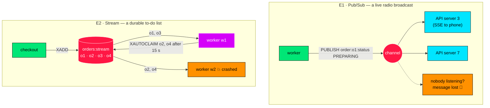

# 🟩 Track E — Events + glue: Pub/Sub, Streams, checkout, kitchen worker

**Files:** `src/LiveUpdates.java`, `src/OrderPipeline.java` (E1/E2, one owner or two), and `src/Checkout.java`, `src/KitchenWorker.java` (I1/I2, **whole team**)
**Check:** `./run.sh check E`  **Demo card:** 3 (Order: checkout + live timeline)

## Warm-up in `redis-cli` (15 min, use three terminals)
```
# terminal 1                        # terminal 2
SUBSCRIBE order:o1:status           PUBLISH order:o1:status hello     # -> (integer) 1
                                    PUBLISH order:o2:status hello     # -> 0: nobody listening, the message is GONE

XADD orders:test * orderId o1 restaurantId r1
XADD orders:test * orderId o2 restaurantId r2
XRANGE orders:test - +                              # the log keeps everything
XGROUP CREATE orders:test kitchen 0
XREADGROUP GROUP kitchen w1 COUNT 1 STREAMS orders:test >     # w1 gets o1
XREADGROUP GROUP kitchen w2 COUNT 1 STREAMS orders:test >     # w2 gets o2 (not o1!)
XPENDING orders:test kitchen                         # 2 pending: read but not acked
XACK orders:test kitchen <id of o1>
XAUTOCLAIM orders:test kitchen w1 0 0-0              # w1 takes over w2's pending entry
```

## Pub/Sub vs Streams — why we need both



| TODO | Where | What |
|---|---|---|
| E1-1 | `LiveUpdates.publish` | `PUBLISH` a JSON status |
| E1-2 | `LiveUpdates.listen` | `Redis.subscribe` loop with idle keep-alives |
| E2-1 | `OrderPipeline.add` | `XADD ... MAXLEN ~ 100000 *` |
| E2-2 | `OrderPipeline.readNew` | `XREADGROUP ... BLOCK ... >` |
| E2-3 | `OrderPipeline.ack` | `XACK` |
| E2-4 | `OrderPipeline.claimStuck` | `XAUTOCLAIM` |
| **I1** | `Checkout.checkout` | session → rate limit → cart → stream → clear → publish |
| **I2** | `KitchenWorker.process` | publish statuses, leaderboard, nearby + lock rider, release |

## Try the full flow
```bash
./run.sh                       # terminal 1: API
./run.sh worker w1             # terminal 2
./run.sh worker w2             # terminal 3
```
On http://localhost:8080: log in → add dosas → **Checkout**, and watch the live timeline. Then:
```bash
./run.sh worker w9 --crash     # place another order: if w9 wins it, it dies holding it...
                               # ...about 15 s later w1 or w2 prints "rescued 1 stuck order(s)"
```

## Think & answer
1. Pub/Sub loses messages when nobody's subscribed. Why is that acceptable for live status, but not for the order queue? What does the customer's app do after reconnecting? (Hint: Assignment 1's `Last-Event-ID`, or fetch the current status.)
2. An entry is processed, but the worker crashes **before** `XACK`. It gets processed again by another worker. Which of your steps are safe to run twice, and which aren't? How do you make `process()` idempotent?
3. Why `MAXLEN ~` (with a tilde) instead of an exact `MAXLEN`?
4. Redis Streams vs Kafka: name two things Kafka gives you that a Redis stream doesn't, and one reason to pick Redis anyway.
5. **Checkout order:** why check the rate limit before reading the cart? Why `XADD` before clearing the cart? What happens if the server dies between those two lines in each order?
6. `KitchenWorker` throws when no rider is free, so the entry stays pending and is retried about 15 s later. What's a "poison message", and how would you stop one from retrying forever? (Hint: the delivery count in `XPENDING`.)

## Stretch
- Dead-letter queue: after 3 deliveries (`XPENDING` with details shows the count), move the entry to `orders:dead` and alert.
- Make `process()` idempotent: `SET order:{id}:done 1 NX EX 86400` at the start, and skip if it's already done.
- Publish rider location every second while `OUT_FOR_DELIVERY` and draw it on the demo page.
